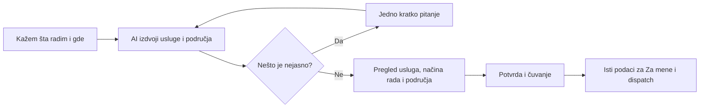

# Nastavak: prirodan razgovor → područje rada → matching

Datum: 18.10.2026. Repo: `USKOCI-EAN`, grana `feature/unified-qa-master-20261017`. Izvor paketa: `48eae637552deff8af5e3694800eb3c272f604de`. Kanonski DEV: `leqcwgzvjsxugfgzdmth`.

## Šta je stvarno završeno

| Deo | Stanje | Dokaz |
| --- | --- | --- |
| Greška sa istim nazivom grada bez provere države | Ispravljena na DEV-u | Migracija `20261018075854`, tačan readback funkcije |
| Provera više lokalnih krugova, administrativne regije i cele države | Napisan i testiran SQL kandidat | Izolovani PostGIS 16/3.5; nije povezan sa aplikacijom |
| Ruta sa početkom, krajem i međutačkama | Kandidat proverava sve radne tačke | Test početka unutar, kraja van, međutačke van, dve odvojene oblasti |
| Nesigurna lokacija na granici oblasti | Kandidat vraća da je potrebna potvrda | Testovi radijusa, poligona, granice i rupa u poligonu |
| „Radim po celoj Srbiji / Vojvodini” kroz stvarni AI i sačuvan profil | Još nije završeno | Nedostaju razrešenje oblasti, potpisani ugovor, čuvanje i kandidatska pretraga |
| Novi APK, nov vizuelni prikaz, stvarni Gemini i push | Nisu rađeni u ovom paketu | Nema tvrdnje da su time provereni |

## 1. Uočena i popravljena greška

Aktivna funkcija `private.worker_need_fit_v1(uuid,uuid,boolean)` do sada je, kada ne može da izračuna udaljenost, poredila samo naziv grada. Jednako napisano mesto je moglo da prođe i kada je država različita ili nedostaje.

Sada ta rezervna provera zahteva i dve jednake, poznate države: `need.task_country_code = worker.operating_country_code`. Ako država nije poznata, naziv grada sam po sebi nije dovoljan. Postojeći račun udaljenosti, REMOTE izuzetak, potpisana usluga/način rada, kategorija, vreme i ostale zabrane ostali su identični u telu funkcije.

Ovo je namerno uzak popravak. Još ne rešava dva istovetna naziva mesta unutar iste države, identitet gradova, terenski rad u više država, celu regiju ili sve tačke rute u aktivnom matcher-u. Za to je potreban novi strukturisani model.

Read-only provera DEV-a pre primene: nula aktivnih radnih profila bez države, jedan ne-REMOTE zadatak bez države i jedno postojeće potpuno poklapanje koje je zavisilo od ove nepotpune geografije. Posle primene u istom agregatnom preseku više nema tog poklapanja. Nisu čitani/prenošeni sadržaji privatnih profila ili adresa. Nije prepravljana lokacija tog zadatka: treba da je potvrdi vlasnik kroz važeći tok.

### Dokaz primene

- Prethodno telo: MD5 `74de2072260579799b651aa69f84cecb`.
- Novo telo: MD5 `7b5d5b5b4f2f3b5d8cefc26333aa6145`.
- Ponovno čitanje: telo se poklapa znak po znak sa kandidatom.
- ACL ostao `{postgres=X/postgres}`, SECURITY DEFINER i `search_path=pg_catalog` očuvani.
- Postoji tačan revert sa proverom prethodnog/novog tela i nepromenjenih prava.
- Primena je urađena po ranijoj stalnoj dozvoli za dokazani paket iz `AGENTS.md` §3.1.10. Nije korišćena stara dozvola za dve Edge instrukcije kao opšta dozvola.
- Receipt: `supabase/operations/dev-alpha/ledger/20261018075854_worker_city_country_guard.receipt.json`.

## 2. Regionalni kandidat koji je napisan

Datoteka `supabase/candidates/worker-coverage-20261018/coverage-core.candidate.sql` uvodi privatnu funkciju `evaluate_worker_coverage_v1` i prazan katalog verzioniranih regija. Ona trenutno nema nijednog pozivaoca u aplikaciji ili aktivnom matching-u.

Podržani oblici područja:

- **Lokalni krug**: potvrđen centar, država i 1–200 km. Dva grada mogu biti dva zasebna kruga; ne pravi se lažni veliki krug između njih.
- **Administrativna regija**: kanonski ID, tačna verzija kataloga, država i proveren poligon. Ime regije nije ključ.
- **Cela država**: eksplicitno potvrđen identitet države. Profilni grad ne daje ovu teritoriju automatski.

Za lokalni zadatak proverava se radna tačka. Za rutu proveravaju se sve radne tačke; početak unutar područja ne opravdava kraj ili međutačku van njega. Ovo nije provera svakog kilometra puta između tačaka. Za REMOTE nema radijusa ili uslova da je naručilac u profilnom gradu.

Zaokružena tačka dobija i neizvesnost u metrima. Ako je blizu granice i nije jasno da pripada području, rezultat je „potrebna potvrda lokacije”. Kod poligona se proveravaju i rupe. Kod cele države kod zemlje mora prethodno biti razrešen na serveru; proizvoljna AI tvrdnja nije dokaz geografije.

Nepoznata verzija kataloga, pogrešna država, nepotpuna ruta ili neispravan oblik ne prolaze. Ne preskaču se neispravni delovi liste. Funkcija vraća samo rezultat geografije (`area`), nikada ukupno `matches=true`: usluga, potvrđen način rada, identitet, ograničenja i vreme i dalje moraju proći u zajedničkom matcher-u.

### Namerno otvorena ograničenja kandidata

1. Nema stvarnog kataloga Srbije/Vojvodine. Testirani poligoni su izmišljeni geometrijski primeri; nisu predstavljeni kao geografski podaci.
2. Katalog mora imati proveren izvor/licencu/verziju, granice i pravilo nepromenljivosti već potvrđenog izdanja. Trenutni location adapter vraća provider candidate hint; to nije trajni ID oblasti.
3. Zadatak tipa AREA_BASED treba ceo potvrđen obuhvat. Kandidat ga vraća na potvrdu; ne uzima proizvoljan centar.
4. Ako disk neizvesnosti prelazi preko dve susedne oblasti, a nije ceo unutar jedne, ostaje na potvrdi. Unija oblasti nije tiho proglašena poklapanjem.
5. Granica je do 32 izbora područja i 32 radne tačke; višak se odbija, ne odseca. To je ograničenje ovog ugovora, ne tvrdnja da ga postojeći ekran već koristi.
6. Lični podaci, njihove revizije, izvoz i brisanje još nisu dodati. Novi privatni katalog utiče na closure potpis, pa njegovu aktivaciju treba obuhvatiti posebnim odobrenim paketom i recertifikacijom.

## 3. Druga važna prepreka: kako dispatch pronalazi radnike

Aktivni `private.candidate_profile_ids(uuid,integer)` prvo pretražuje radnike sa približnom tačkom u krugu od najviše 300 km od jedne tačke zadatka. Radnik koji ima tačku van tog kruga ne ulazi u kasniju rezervnu granu namenjenu profilima bez koordinata.

Zato dodavanje „cela Srbija” u profil i samo zamena geografske provere ne bi završili posao. Takav radnik može da ispadne pre pozivanja matcher-a. Buduća pretraga mora da objedini lokalne, regionalne i državne kandidate, ukloni duplikate pre limita i primeni isto pravilo uklapanja. Treba proveriti i pravedan redosled, opterećenje, ponovnu obradu otvorenih zadataka posle izmene profila i idempotentnost događaja.

Push ostaje poslednji deo lanca. Prolaz geografije ili `matches=true` ne dokazuje isporučeno obaveštenje. Potrebni su korisnikov izbor obaveštenja, dozvoljen događaj, uređaj i uspešan transport. Nijedan push nije poslat u ovom paketu.

## 4. Kako ovo treba da izgleda korisniku

Željeni tok ostaje jedan razgovor i jedan pregled:

Primer: „Živim u Novom Sadu, radim montažu po Vojvodini, a 3D figurice izrađujem kod sebe i šaljem.” Pregled treba da pokaže profilni grad Novi Sad; montažu na lokaciji u potvrđenoj Vojvodini; 3D izradu na daljinu. Ne sme da pretvori adresu dostave u mesto terenskog rada, niti da radnu teritoriju zaključi iz grada stanovanja.

UI treba da prikazuje samo podatke koji stvarno učestvuju u usmeravanju. Za izmene je glavni put „Uredi kroz razgovor”. Oprema i vozila su opcioni opis, bez obaveznog upitnika ili obećanja da određuju prijem zadataka. Sačuvani ekran mora ponovo da pročita potvrđene usluge, načine rada i područja iz servera.

U aktuelnom izvornom `WorkerProfileSaved.tsx` još postoje ručni ulazi u područje/nedeljni raspored i prekidač „Mogu odmah”; `WorkerDraft` još nosi jedan grad/radijus bez potvrđenih teritorija i načina rada po usluzi. To je konkretan preostali deo AI-only migracije. Nije dovoljno nacrtati novu karticu dok njen server ugovor ne postoji. Ovaj paket nije menjao te ekrane.

## 5. Testovi i njihove granice

[GitHub Actions — Worker coverage geography, run 39109590162](https://github.com/uskocibusiness-boop/USKOCI-EAN/actions/runs/39109590162): SUCCESS na tačnom izvornom komitu `48eae637`.

Izvršeno:

- Lokalna tri testa: tačno prethodno telo, tačan revert, dozvoljeni obim izmene i kontrolne zaštite.
- Prava odvojena PostgreSQL/PostGIS baza: očekivani FAIL pre country popravke, PASS posle, povratak na prethodno ponašanje, ponovna primena i PASS.
- Geografski primeri: dva odvojena centra, država, druga država, sve tačke rute, područje između centara, ivica, rupa, različite verzije, nepoznati katalog, nesigurnost, neispravni i preveliki ulazi.
- Zatvorena prava za anon/authenticated/service_role i uključeni RLS kataloga; kandidat ne izlaže javni RPC.
- Revert praznog regionalnog kandidata i ponovna primena u test bazi.
- DEV readback i agregatna provera stvarnog efekta country popravke.
- Osvežen metadata snimak potvrđuje requester Edge v89 i worker Edge v44. U prethodnom receipt-u worker v44 ispravljen je nepotpuno prepisan bundle hash, uz sačuvanu originalnu vrednost i napomenu o korekciji; nije bilo nove Edge objave.

Fixture namerno zamenjuje pojedine delove taksonomije, vremena, identiteta i closure-a sintetičkim pomoćnim funkcijama. To nije dokaz njihove potpune ispravnosti. Stvarni closure i ACL su zasebno pročitani na DEV-u. Nisu pozivani Gemini, geocoder, Expo push; nije izgrađen APK; nije izvršen ceo `npm test` u ovom paketu jer se nisu menjali mobilni moduli.

## 6. Zatečeno neslaganje closure sertifikata

Pre i posle ove primene:

- Aktuelni digest: `88cab17911f89a7d8d800ae229db568dd2aaed106395ad8acc3207917acd72ec`.
- Sačuvani sertifikovani digest: `0201a7ccf74a3a5d0ed397d714392881af6ea1056b42f549097f9d3ecd9a4acb`.

Iste vrednosti su već bile u prethodnom `dev_snapshot.json`; ovo nije novonastalo neslaganje iz country popravke. Nijedan digest nije menjan i recertifikacija nije rađena. Ne treba tvrditi da je account-closure sertifikacija aktuelna. Utvrđivanje uzroka i pravilna recertifikacija su odvojeni posao, posebno pre novih tabela vezanih za profil.

## Sledeći povezani korak

Proširiti verzionirani kandidat i potpisani pregled radnog profila podacima o područjima po usluzi, zajedno sa vlasništvom, revizijom, čuvanjem, ponovnim čitanjem, izvozom i brisanjem. Paralelno pripremiti dokaz da proširena kandidatska pretraga ne izostavlja regionalne/državne radnike. Tek zatim povezati AI razrešenje mesta i jednostavan ekran pregleda, pa odraditi ovlašćenu probu celog lanca na emulatoru. Regionalni kandidat ne treba pustiti kao izdvojenu funkciju koja u aplikaciji izgleda dovršeno.

Primarni tehnički izvori: [Supabase PostGIS](https://supabase.com/docs/guides/database/extensions/postgis), [ST_Covers](https://postgis.net/docs/ST_Covers.html), [ST_DWithin](https://postgis.net/docs/ST_DWithin.html).
