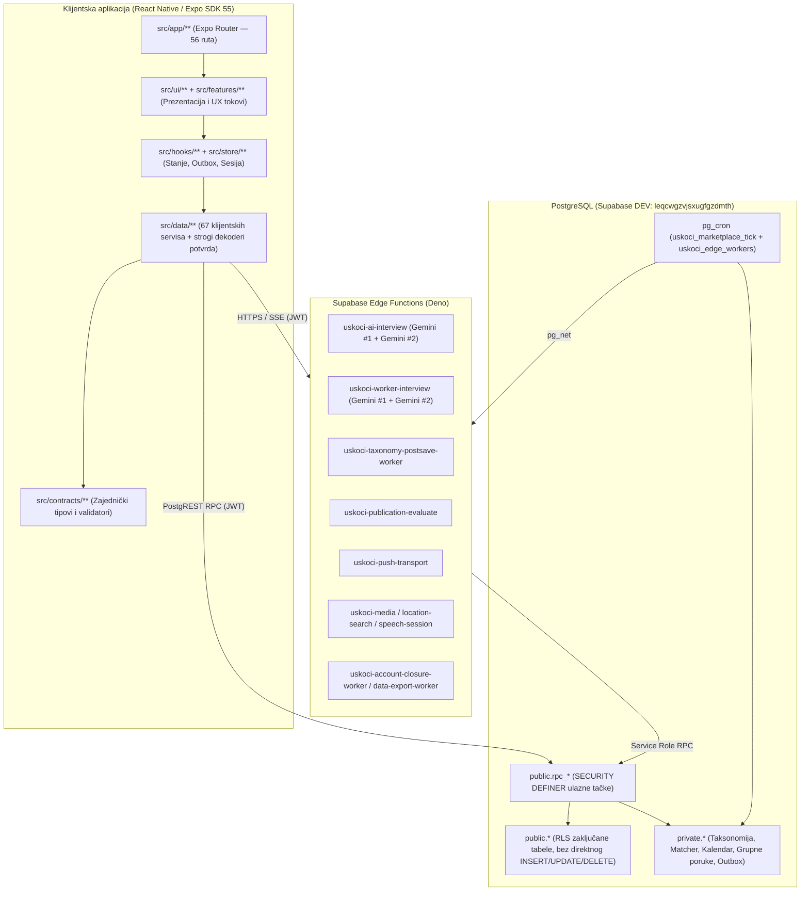

# 02 — System Architecture & Client Module Map

## 1. Arhitekturni slojevi

USKOČI je izgrađen kao troslojni sistem sa strogom granicom odgovornosti:

---

## 2. Mapa klijentskih modula (`src/`)

| Modul | Putanja | Odgovornost i ključni fajlovi |
|---|---|---|
| **Rute (Expo Router)** | `src/app/` | 56 ruta: `_layout.tsx` (Root provideri, fontovi, `AuthGate`, `PushRuntime`), `(auth)/*`, `(onboarding)/*`, `(app)/*` (tabovi i ekrani zadataka/profila), `dogovor/[id]*`, `podrska/*`, `pravno/*`, `profil/[id].tsx`, `obavestenja.tsx`. |
| **Dizajn sistem i UI** | `src/ui/` | `src/ui/system/tokens.ts` (kanonski tokeni), `src/ui/v2/` (Discovery, Home, Agreement, Profile prezentacije), `src/ui/workerProfile/` (javni i vlasnički prikaz radnog profila), `src/ui/agreements/` (pregled Dogovora, akcije, deljenje kontakta/lokacije), `src/ui/groups/` (grupni chat), `src/ui/reviews/` (ocenjivanje), `src/ui/icons/UskociIcons.tsx` (2.5D dvobojne ikone). |
| **Funkcionalne celine** | `src/features/` | `src/features/need-intake/` (`UnifiedTaskCreationScreen.tsx` — AI razgovor za zadatak), `src/features/worker-ai/` (`WorkerAiInterviewScreen.tsx`, `WorkerAiReviewScreen.tsx` — AI razgovor i pregled radnog profila), `src/features/location/` (`LocationPickerModal.tsx`, `MapPinPicker.tsx`). |
| **Sloj podataka i RPC adapteri** | `src/data/` | 67 servisa (`supabaseIzvor.ts`, `aiTaskReviewClientService.ts`, `workerAiClientService.ts`, `applicationSelectionClientService.ts`, `agreementClientService.ts`, `inboxClientService.ts`, `pushDeviceClientService.ts`, itd.). Svi odgovori prolaze kroz `serverReceipt.ts` (`readOwnedResult`) koji proverava vlasništvo naloga (`accountId`), reviziju sesije (`accountRevision`) i očekivani oblik JSON-a. |
| **Ugovori (Contracts)** | `src/contracts/` | Deljeni ugovori između klijenta i Edge funkcija: `needFactsV2.ts`, `serviceHandoff.ts`, `taskApplicationDeadline.ts`, `aiAvailability.ts`, `location.ts`, `publication.ts`. |
| **Stanje i keširanje** | `src/store/` + `src/state/` | `src/store/sesija.ts` (Zustand sesija sa `accountRevision` ogradom), `src/store/profil.ts`, `src/store/filteri.ts`, `src/state/DraftStateContext.tsx`, `src/lib/discoveryV1WarmReturn.ts` (5-minutni memorijski keš mape, pinova, filtera i skrola). |

---

## 3. Upravljani životni ciklus sesije i otpornost na prekid

1. **Ograda revizije naloga (`accountRevision`):** Svaka promena korisnika ili odjava u `src/store/sesija.ts` inkrementira `accountRevision`. Svi asinhroni pozivi u `src/data/**` proveravaju da li je `accountRevision` ostao isti pre nego što prihvate rezultat ili upišu stanje u UI.
2. **Idempotentni dnevnici komandi (`AsyncStorage` journals):**
   - Slanje AI poruke (`workerAiTurnJournal`, `needTurnJournal`),
   - Podnošenje prijave na zadatak (`applicationCommandJournal.ts`),
   - Izbor kandidata i akcije u Dogovoru (`AgreementActionsController.ts`),
   - Slanje poruka u chatu (`useAgreementOutbox.ts`).
   Svaka od ovih radnji pre mrežnog poziva čuva `clientRequestId` lokalno i pri povratku u aplikaciju proverava stvarni ishod na serveru pre ponovnog slanja.
