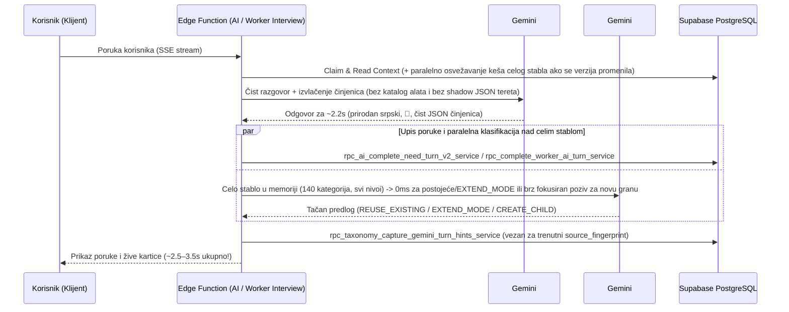

# 04 — AI Interviews: Dual-Gemini Architecture („Dva mala Geminija u paru")

## 1. Dijagnoza ranijeg uskog grla (Zašto je odgovor trajao 11–18 sekundi)

U prethodnoj arhitekturi (`USKOCI_TAXONOMY_UNIFIED_SHADOW`), jedan isti Gemini poziv u glavnom toku poruke morao je istovremeno da:
1. Pre pisanja odgovora izvrši 3–5 RPC upita za delimični katalog (`createClassificationExplorer` -> `prepareDirectCatalogContext`).
2. Vodi prirodan razgovor sa korisnikom i popuni strukturisana polja zadatka ili radnog profila.
3. Generiše ogroman ugnježdeni JSON string `classificationShadowJson` (sa UUID-ovima, roditeljima, putanjama i obrazloženjima na osnovu delimičnog pogleda u katalog).
4. Ako usluga nije u prvih 40 rezultata pretrage ili zahteva proširenje načina rada (`EXTEND_MODE` / `CREATE_CHILD`), ulazi u sporu petlju pozivanja alata (`generateGeminiToolConversation`, 2 do 4 uzastopna poziva Geminiju).
5. Posle odgovora izvršava još 3–5 verifikacionih RPC poziva (`explorer.verify()`).

Posledica: Korisnik je čekao **11 do 18 sekundi po poruci**, a Gemini #1 u direktnom režimu nije video celo stablo taksonomije.

---

## 2. Nova arhitektura: Dva mala Geminija u paru (`backgroundTaxonomyArchitect.mjs`)

Uvedena je i povezana u `uskoci-ai-interview/index.ts` i `uskoci-worker-interview/index.ts` čista podela odgovornosti:

### 2.1 Gemini #1 — Brzi Sagovornik
- **Jedini posao:** Da razgovara prirodno, toplo i ljudski na srpskom jeziku (uz umeren emotikon `🙂`), razume sve što je korisnik rekao u jednoj poruci, zapamti delimične odgovore, prihvati ispravke i pita samo ono što još nedostaje za objavu zadatka ili čuvanje radnog profila.
- **Bez nepotrebnog tereta:** Ne učitava katalog pre odgovora, ne nosi `classificationShadowJson` u svom izlaznom JSON-u i ne poziva `taxonomy_catalog` alate.

### 2.2 Gemini #2 — Pozadinski Arhitekta stabla (`supabase/functions/_shared/backgroundTaxonomyArchitect.mjs`)
- **Vidi CELO stablo taksonomije odjednom:** `loadFullCatalogTree(rpc)` učitava svih 140+ kategorija kroz sve nivoe dubine (`ROOTS` -> `CHILDREN`) i kešira ih u memoriji Edge instance po `catalogVersion` + `catalogFingerprint`. Na svakom sledećem potezu provera `META` verzije traje ~80ms, a čitanje celog stabla iz memorije **0ms**.
- **0ms rezolucija za postojeće usluge i proširenje načina rada:**
  - Ako usluga već postoji u katalogu (po tačnom nazivu ili registrovanom alijasu) i podržava traženi mod (`ON_SITE` ili `REMOTE`), u **0ms** vraća `REUSE_EXISTING` sa tačnim `categoryId`.
  - Ako usluga već postoji u katalogu pod drugim modom (npr. `Poliranje dragog kamenja` postoji kao `ON_SITE`, a korisnik traži `REMOTE` slanje kurirom), u **0ms** prepoznaje postojeći čvor i vraća `EXTEND_MODE` na istom `categoryId` — bez dupliranja grana!
- **Pametno smeštanje novih usluga (`CREATE_CHILD`):**
  - Samo kada usluga zaista ne postoji nigde u katalogu, poziva se fokusirani Gemini #2 klasifikator koji u promptu vidi **kompletno hijerarhijsko stablo svih grana i podgrana** i bira najtačnijeg roditelja (`parentId`, `proposedPath: [service]`).
  - Odluka za istu novu uslugu se kešira u `cachedNovelDecisions`, tako da naredne poruke u istom razgovoru (kada korisnik odgovara na cenu, rok ili lokaciju) ponovo traju **0ms** za taksonomiju!
- **Garantovana spremnost za Pregled (`source_fingerprint`):**
  - Pošto SQL funkcija `taxonomy_review_candidate_projection_v2` traži hint vezan za trenutni `source_fingerprint` (koji se menja sa svakom novom činjenicom u razgovoru), upis hinta u `rpc_taxonomy_capture_gemini_turn_hints_service` izvršava se odmah uz kompletiranje poteza, čime je `classificationState: 'READY'` garantovan čim korisnik otvori završni pregled.
