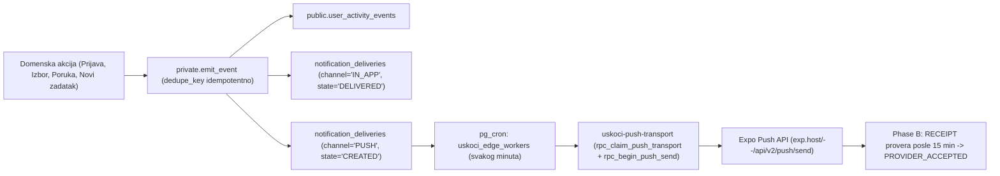

# 07 — Notifications & Push Architecture

## 1. End-to-End tok obaveštenja

---

## 2. Registracija uređaja i vezivanje za sesiju (`notification_push_devices`)

- Svaki fizički token uređaja (`expo_push_token`) ima parcijalni jedinstveni indeks `push_device_active_token_owner_idx ON (expo_push_token) WHERE active`. Jedan telefon nikada ne može biti aktivan za dva različita naloga u isto vreme.
- Klijent (`src/data/pushDeviceClientService.ts` + `PushRuntime.tsx`) poziva `rpc_set_push_device_owned` i `rpc_rotate_push_device_owned`, koji proveravaju `auth.jwt()->>'session_id'` u `auth.sessions`.
- Prilikom odjave (`revokePushBeforeLogout`), klijent poziva `rpc_revoke_push_session` pre gašenja sesije.

---

## 3. Stroga razlika između pokušaja slanja, prihvatanja provajdera i otvaranja

U bazi se nikada ne lažira status isporuke:
1. **`notification_deliveries.state = 'CREATED'`:** Događaj čeka u redu za slanje.
2. **`notification_deliveries.state = 'SENT'` (`transport_state = 'TICKET_PENDING'`):** Expo Push API je prihvatio zahtev i vratio `ticketId`.
3. **`notification_push_attempts.transport_state = 'PROVIDER_ACCEPTED'`:** Posle 15 minuta, Expo `getReceipts` je potvrdio da su FCM/APNs prihvatili poruku.
4. **Nevažeći token (`DeviceNotRegistered`):** `rpc_complete_push_transport` odmah deaktivira `notification_push_devices` red za taj token.
5. **Čitanje/otvaranje (`state = 'READ'`):** Beleži se isključivo na `IN_APP` redu kada korisnik zaista otvori obaveštenje ili prikaže poruku u razgovoru (`rpc_mark_agreement_messages_displayed_v2`).

---

## 4. Pravila privatnosti i Deep-Link rutiranja pri dodiru

- **Privatnost na zaključanom ekranu:** `rpc_begin_push_send` nikada ne šalje privatan tekst poruke niti tačnu adresu kroz FCM/APNs payload, već generičan bezbedan naslov i `{ kind: 'INBOX', eventId, eventType }`.
- **Autoritativni Deep-Link (`useMessagePushIngress.ts`):**
  - Dodir na push obaveštenje otvara `/obavestenja` sa sačuvanim `messagePushIntent`-om, gde klijent poziva serverski resolver koji proverava vlasništvo i prava pre preusmeravanja:
    - `MESSAGE_RECEIVED` → `rpc_resolve_activity_message_v1` → `/dogovor/[id]?tab=poruke&messageId=...` ili `/dogovor/[id]/grupa`
    - `OPPORTUNITY_AVAILABLE` → `rpc_resolve_activity_opportunity_v1` → `/prilike/[id]`
    - `RESPONSE_RECEIVED` / `RESPONSE_UPDATED` → `rpc_resolve_activity_application_v1` (`20261021103645`) → `/potrebe/[id]/kandidati?prijavaId=...`
- **Otvorena stavka za DEV primenu:** Migracija `20261021103645` (koja dodaje `eventId` u `rpc_begin_push_send` za `RESPONSE_RECEIVED` i `RESPONSE_UPDATED`) je pripremljena u repozitorijumu i treba je primeniti na DEV serveru kako bi dodir na push o novoj prijavi vodio direktno na ekran kandidata.
