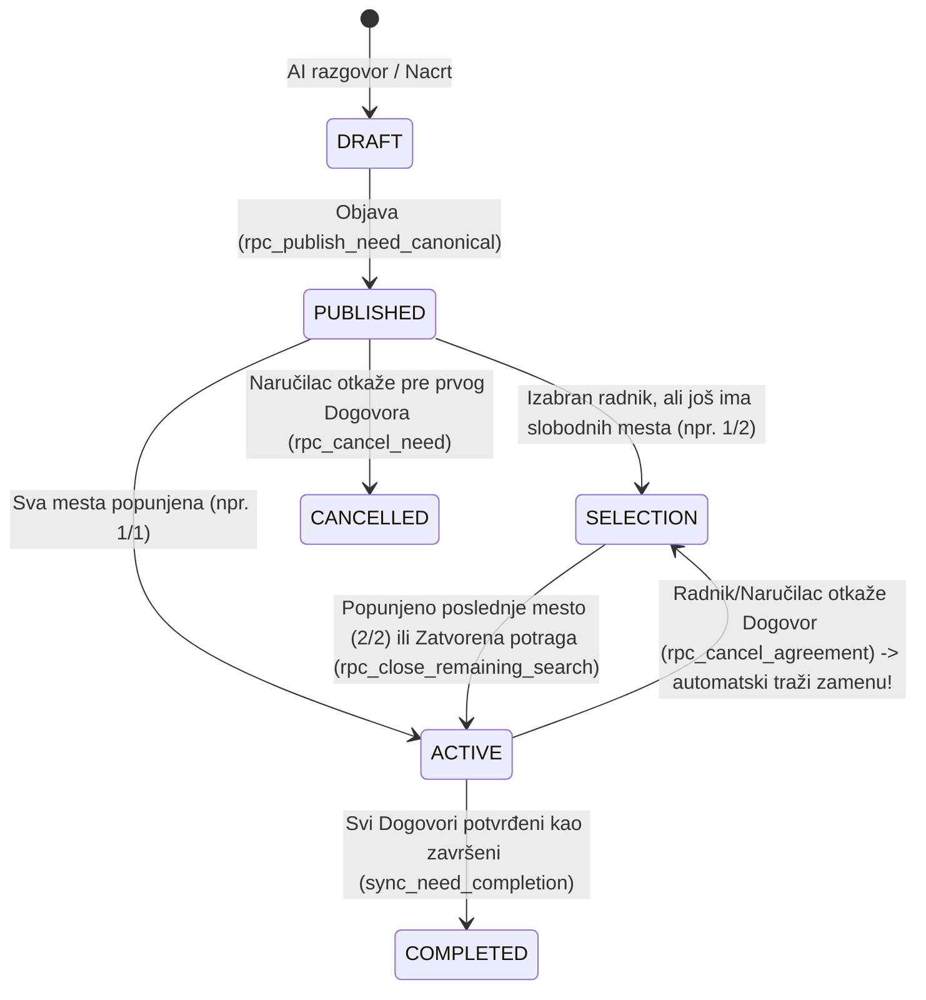

# 11 — Agreements, Task Lifecycle & Chat

## 1. Državni model (State Machine) Zadatka i Dogovora

### Stanja izvršenja pojedinačnog Dogovora (`public.agreement_execution.state`)
1. **`CONFIRMED`:** Dogovor je sklopljen; rad je u pripremi ili u toku. Dozvoljene su: poruke, svesno deljenje telefona/adrese, predlog izmene uslova (`rpc_propose_agreement_change_v2`), otkazivanje uz razlog (`rpc_cancel_agreement`), oznaka radnika **`Zadatak je gotov`** (`rpc_mark_work_done`) ili direktna potvrda naručioca **`Potvrdi završetak`** (`rpc_confirm_completion`).
2. **`AWAITING_REQUESTER`:** Radnik je označio da je zadatak gotov. Postavlja se `requester_deadline_at = now() + 48 hours`.
   - Ako naručilac klikne **`Potvrdi završetak`** (`rpc_confirm_completion`) → prelazi u `COMPLETED`.
   - Ako naručilac ne odgovori u roku od **48 sati** i nije prijavljen problem (`problem_opened_at IS NULL`) → `pg_cron` (`rpc_tick_auto_completion`) automatski prelazi u `COMPLETED`.
   - Ako bilo koja strana prijavi problem (`rpc_report_problem`) → postavlja se `problem_opened_at`, što **zaustavlja automatski tajmer od 48 sati** dok se problem ne razreši ili eskalira podršci (`/podrska/novi`).
3. **`COMPLETED`:** Zadatak je uspešno izvršen. Otvara se dvostrano ocenjivanje (**`Oceni saradnju`** → `/oceni-dogovor`).
4. **`CANCELLED`:** Dogovor je otkazan pre završetka. Svi `access_grants` (telefon/adresa) se automatski opozivaju (`REVOKED`), a zadatak se automatski vraća u potragu za zamenom (`SELECTION` + `enqueue_dispatch`).

---

## 2. Razgovori (1-na-1 i Grupni chat) i Svesno deljenje podataka

1. **1-na-1 Razgovor (`AgreementThreadPresentation.tsx`):**
   - Prikazuje karticu/naslov zadatka u zaglavlju, tekstualne poruke, privatne fotografije (do 6 po poruci kroz `uskoci-media` i `rpc_send_agreement_photo_message_v5`) i glasovne poruke (`rpc_send_agreement_voice_message_v1`).
   - **UX unapređenje za `AgreementWorkspace.tsx`:** Ukloniti duplirani ugnježdeni mini-čet (`AgreementChat.tsx` sa `maxHeight: 360`) sa dna ekrana pregleda Dogovora i zameniti ga čistom karticom koja prebacuje na pun ekran razgovora (`tab='poruke'`), uz jedinstven stil mehurova (`MessageBubbles.tsx`).
2. **Grupni razgovor (`/dogovor/[id]/grupa` — `GroupConversationScreen.tsx`):**
   - Automatski se aktivira čim zadatak ima 2 ili više izabranih izvršilaca (`private.group_sync_agreement_v5`).
   - Omogućava naručiocu i svim izabranim radnicima zajedničku koordinaciju, uz trenutni prelaz između grupnog kanala i privatnog 1-na-1 razgovora sa svakim radnikom.
3. **Svesno i smerno deljenje kontakta i lokacije (`AgreementContactPlace.tsx`):**
   - Broj telefona (`PHONE`) i tačna adresa (`EXACT_LOCATION`) dele se isključivo klikom na dugme u Dogovoru (`rpc_set_contact_grant`) uz mogućnost opoziva (`rpc_revoke_contact_access`), kao i jednokratnog deljenja trenutne GPS tačke (`rpc_write_agreement_current_location`).
